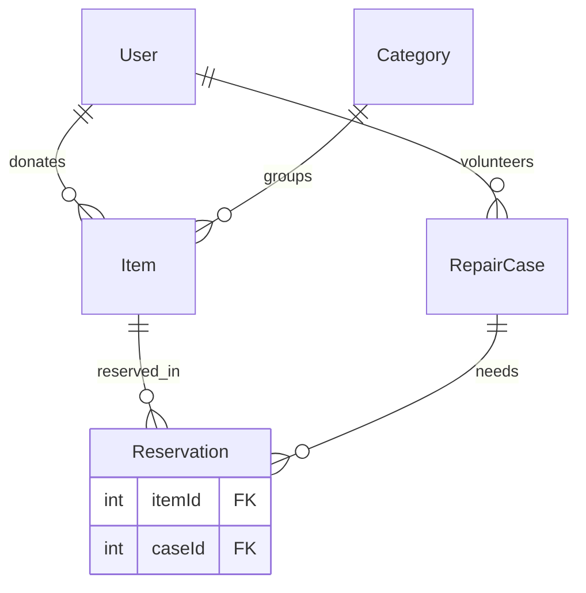

# ธนาคารเศษวัสดุก่อสร้างเหลือใช้ (Community Material Upcycling Bank)

เว็บแอปส่งต่อเศษวัสดุก่อสร้างจากคนในเมืองให้ช่างอาสานำไปซ่อมแซมบ้านผู้ยากไร้/ผู้สูงอายุ

**Stack:** Vite + React + TypeScript · React Router v7 · Zustand (Client State) · TanStack Query (Server Cache) · Tailwind CSS v4 · Express + TypeScript · PostgreSQL + Prisma 6

## วิธีรัน

```bash
# 1) Backend
cd server
cp .env.example .env        # แก้ DATABASE_URL ให้ตรงกับ PostgreSQL ของคุณ
npm install
npx prisma migrate dev --name init
npx prisma db seed          # seed 56 รายการ (30 วัสดุ + 8 เคส + 8 การจอง + 6 ผู้ใช้ + 4 หมวด)
npm run dev                 # http://localhost:4000

# ถ้าฐานข้อมูลมีอยู่แล้ว (เช่น Supabase) และอยากได้ตารางเวอร์ชันล่าสุดโดยไม่ลบข้อมูล
npx prisma migrate deploy   # เพิ่มช่องที่อยู่ จังหวัด/เขต-อำเภอ/แขวง-ตำบล แทน lat/lng
npm run db:images           # อัปเดตรูปวัสดุให้ตรงกับชื่อ

# 2) Frontend (เปิดอีกเทอร์มินัล)
cd client
npm install
npm run dev                 # http://localhost:5173  (proxy /api -> :4000)
```

## API

| Method | Path | หน้าที่ |
|---|---|---|
| GET/POST | `/api/items` | รายการ (กรอง `q` = ชื่อ/รายละเอียด/จังหวัด/เขต/แขวง, `categoryId`, `status`) / เพิ่ม |
| GET/PUT/DELETE | `/api/items/:id` | รายละเอียด / แก้ไข / ลบ |
| GET/POST | `/api/cases` | เคสซ่อมบ้าน |
| GET/PUT/DELETE | `/api/cases/:id` | รายละเอียดเคส (พร้อมวัสดุที่จอง) / แก้ไข / ลบ |
| GET/POST | `/api/reservations` | จองวัสดุ (transaction + ตรวจจำนวนคงเหลือ) |
| PATCH | `/api/reservations/:id/pickup` | รับของจริง = ตัดสต็อก |
| PATCH | `/api/reservations/:id/cancel` | ยกเลิก คืนจำนวนเข้าสต็อก |
| GET | `/api/categories`, `/api/users`, `/api/stats` | ข้อมูลประกอบ |

Status code: 200/201/204 สำเร็จ · 400 ข้อมูลไม่ถูกต้อง (Zod) · 404 ไม่พบ · 409 จำนวนไม่พอ/จองซ้ำ · 500 ข้อผิดพลาดภายใน

## ER Diagram



`Reservation` มี `@@unique([itemId, caseId])` ป้องกันเคสเดิมจองวัสดุชิ้นเดียวกันซ้ำ
ภาพ Schema สำหรับส่งงาน: เปิด `npx prisma studio` หรือวาง `schema.prisma` ใน dbdiagram.io / paste mermaid ด้านบนที่ mermaid.live

## ก่อนส่งงาน

ลบ `node_modules` และ `dist` ทั้งใน `client/` และ `server/` แล้วบีบอัดเป็น `final_proj_<รหัสนักศึกษา>.zip`
